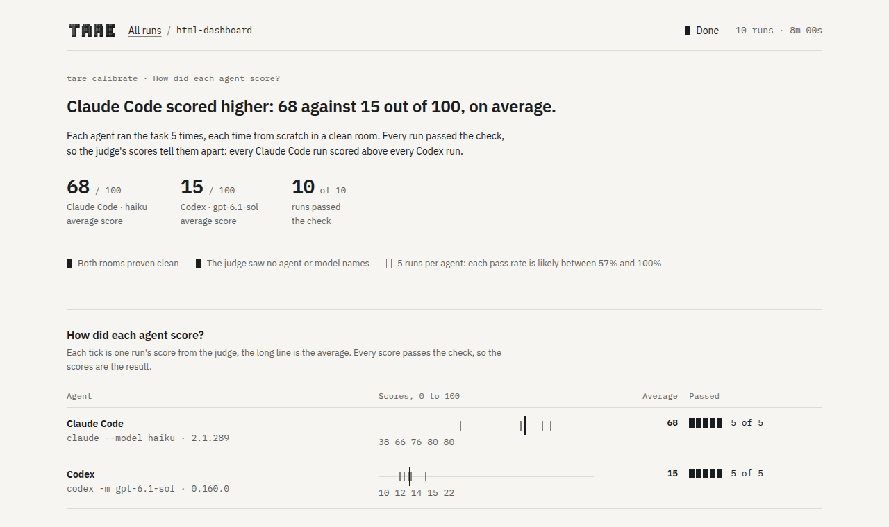

# Calibrate: how often does each side pass?

[← Documentation](README.md) · [Measuring agents in rooms](measuring.md)

Use Calibrate to compare skills, plugins or models: it starts each side several times from
scratch, each run in its own room, and reports how often each side passes a check.

```bash
tare calibrate "fix the failing test" --check "uv run pytest -q" \
  --side "claude --model haiku" --side "codex -m gpt-6.1-sol" --runs 10
```

Each `--side` is an agent with its arguments. tare starts every side `--runs` times from a fresh
copy of the project and reports each side's pass rate with its [likely range](measuring.md#the-likely-range).

<picture>
  <source media="(prefers-color-scheme: dark)" srcset="assets/dashboard-calibrate-dark.png">
  
</picture>

Calibrate also tells you whether a task suits Swap or Cliff. [Swap](swap.md) needs a task where
one side mostly fails and the other mostly passes. [Cliff](cliff.md) needs a task where a fresh
start passes at least sometimes.

## Which skills and tools each side used

For each finished run, tare counts the skills the agent loaded and the tools it called, from the
agent's own output. The report adds two lines per side, and the dashboard shows the same while the
runs go on:

```
  skills    a  greet in 7 of 10 runs, 0.9 per run · review in 2 of 10 runs, 0.2 per run
            b  none loaded
  tools     a  Bash 6.2 · Read 3.1 · Skill 1.1 · Write 0.8 per run
            b  command_execution 9.4 · file_change 1.0 per run
```

A skill counts as loaded when the agent invoked it (Claude Code's `Skill` tool) or read its
`SKILL.md`, which is how Codex, Pi and the Antigravity CLI load a skill (the Copilot CLI has a skill
tool, as Claude Code does). The name is the folder that
holds the file. A shell command counts the folders it names, whatever it does with the file (also
in a comment, a heredoc or a commit message), but not a glob, a variable or `./SKILL.md`, which name no folder; a
folder name with a space or a letter outside ASCII comes through only from a read tool. A loaded skill is not necessarily a followed one: the
count says only that the agent read it. Tool names are the ones the agent's output uses; Codex
names the kind of call (`command_execution`, `file_change`) rather than the tool. The run's journal
carries the counts, so `tare watch` shows them for a finished run too, and the run directory keeps
them in `uses.json` (per side) and in each run's `result.json`.

## Different prompts per side

Some skills start with their own command, for example a slash command, so the sides need
different prompts. `--side-prompt` gives a side its own prompt. The sides are named a, b and c in
the order of `--side`:

```bash
tare calibrate --side "claude --plugin-dir plugins/a" --side "claude --plugin-dir plugins/b" \
  --side-prompt "a=/a:ideate a todo app" --side-prompt "b=/b:ideate a todo app" --runs 5
```

## Without a check

Without `--check`, a run counts as finished when its agent exits with 0. tare keeps each finished
workspace, and the report shows the finished runs and their times, so that you can score the
results elsewhere, for example with a [judge](judge.md). `--keep` keeps the workspaces when there
is a check too.
