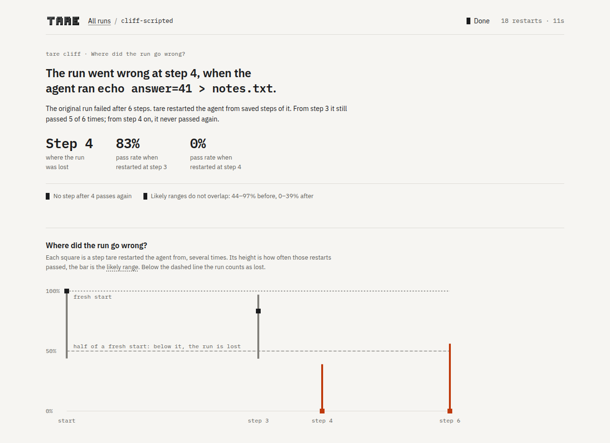

# Cliff: where did a failed run go wrong?

[← Documentation](README.md) · [Measuring agents in rooms](measuring.md)

A failed run is a chain of steps. Somewhere in that chain, the run may have taken a turn that it
could not recover from. Cliff looks for that step, the step where the run was lost. Before it
the run could still succeed, after it the run no longer does.

```bash
tare cliff claude "fix the failing test" --check "uv run pytest -q" -- --model sonnet
```

> **Experimental.** Cliff finds the known step in tare's scripted test. On real runs it has
> never blamed a step that was not the cause. But it has not yet found such a step in a real run
> either, because neither of two real test rounds had a failure that sat in one step. The rounds
> were a [data migration](../experiments/migration/RESULTS.md) and a [web page](../experiments/html/RESULTS.md).

<picture>
  <source media="(prefers-color-scheme: dark)" srcset="assets/dashboard-cliff-dark.png">
  
</picture>

## How the search works

tare runs the task once in a room and saves the workspace and the conversation after every step.
If the check fails, Cliff restarts the agent from saved steps in fresh rooms. Restarts from the
beginning are **fresh starts**. They show how often the task succeeds at all.

Cliff first runs three fresh starts and three restarts from the last step. A step counts as good
while its restarts pass at least half as often as a fresh start. Cliff then halves the range
between the last good step and the first bad one, three restarts at a time (`--restarts`). When the
two are neighbours, it adds restarts to both until their likely ranges no longer overlap, or until
the budget (`--budget`, default 30 restarts) is spent. Everything after `--` goes to every agent run, so pin the model there.

## When Cliff names no step

Cliff can also end without naming a step. When even a fresh start almost never passes, the task
is too hard for the model, and Cliff says so. It does so only when the upper end of the fresh
starts' likely range lies below `--too-hard-below` (default 0.2). When restarts from the last step
pass at least half as often as a fresh start, the run was unlucky, not lost, and Cliff says that.

## A report

The report below comes from tare's scripted test, with a scripted model that writes the wrong
answer into a note at step 4. Steps that Cliff did not need are missing from the table, and `<`
marks the step where the run was lost. `after it` says whether a later step passes again.

```text
  step  what the step did                                   restarts  pass  rate  likely range
     0  start                                                     3     3  1.00  0.44-1.00
     3  Bash echo hi > scratch.txt                                6     5  0.83  0.44-0.97
     4  Bash echo answer=41 > notes.txt                           6     0  0.00  0.00-0.39 <
     6  Bash echo 41 > answer.txt                                 3     0  0.00  0.00-0.56

  verdict   The run became lost at step 4.
  at step 4: Bash echo answer=41 > notes.txt
  changed   notes.txt
  after it  no step after it passes again
  restarts  18 of a budget of 30
```

## Agents

Cliff works with all four agents (`tare cliff pi ...`). Claude Code, Codex and Pi continue their
own saved session. The Antigravity CLI stores its sessions in a format that tare cannot cut, so
Cliff continues it with a handover note, as [Swap](swap.md) does. Each restart is a real agent
run, so a search costs as much as its restarts.
