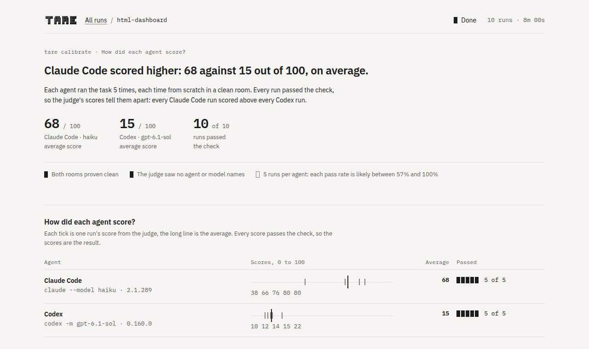
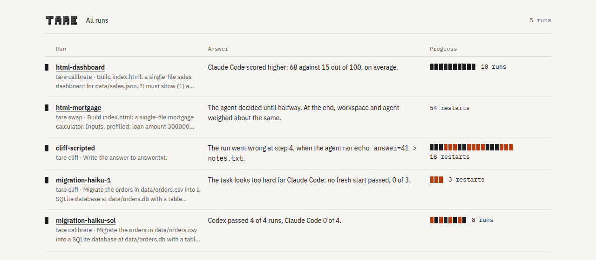

# Dashboard and rerun

[← Documentation](README.md) · [Measuring agents in rooms](measuring.md)

## Watch it live

The live dashboard of `tare calibrate`, `tare swap` and `tare cliff` runs at
`http://localhost:8777/` unless that port is taken. Every run page opens with the answer: one
sentence that says what the run found, the figures behind it, and a line on how far to trust them
(was the room clean, how many runs, do the likely ranges overlap). Below come the questions a
newcomer would ask, each as a section: how each agent did, how tare tested it, whether the room
was clean, what ran, what it cost, and the full report, folded away. While a run goes on, the
answer starts with "So far" and every running restart pulses.

<picture>
  <source media="(prefers-color-scheme: dark)" srcset="assets/dashboard-calibrate-dark.png">
  
</picture>

The page follows your system's light or dark setting and works offline: its fonts (IBM Plex,
under the SIL Open Font License) ship with tare.

```bash
tare watch ~/.local/state/tare/cliff/myproject-20261005-142000   # any run, live or finished
tare watch ~/.local/state/tare/calibrate/*                         # several runs: one row each
```

With several runs, `tare watch` opens an overview: every run with its answer and its progress,
running ones first.

<picture>
  <source media="(prefers-color-scheme: dark)" srcset="assets/dashboard-overview-dark.png">
  
</picture>

## Repeat it

```bash
tare rerun ~/.local/state/tare/cliff/myproject-20261005-142000   # the same run again
```

Every run directory holds a `recipe.json` with the command, the task and the check, a fingerprint
of the project, the agents with their versions and arguments, and the settings. `tare rerun`
repeats the run in a new directory with the same settings and says what has changed since and
what the repeated run used. Agent runs are not deterministic, so a repeated run can still come out
differently.
