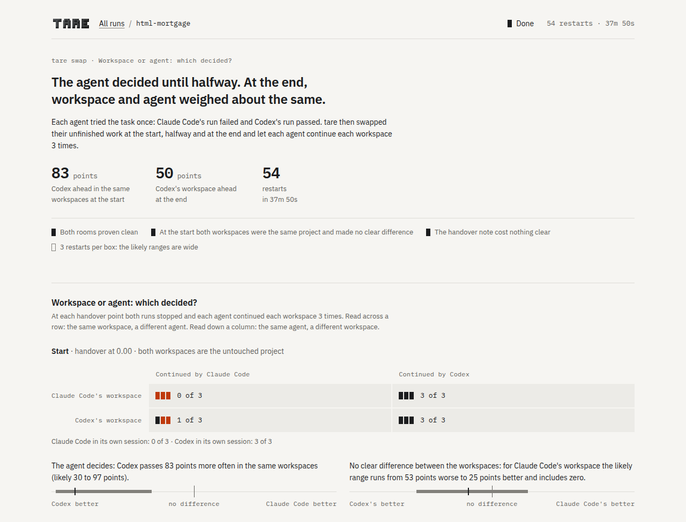

# Swap: was it the workspace or the agent?

[← Documentation](README.md) · [Measuring agents in rooms](measuring.md)

When one agent fails a task and another passes, two causes are possible. The agent may be the
weaker one. Or its workspace may have reached a state that no agent can finish. Swap lets the two
agents continue each other's unfinished work and separates the two causes.

```bash
tare swap "fix the failing test" --check "uv run pytest -q" --a claude --a-args "--model sonnet" --b codex
```

Two agents, a and b, each attempt the same task once. [Calibrate](calibrate.md) first tells you
whether a task suits Swap: it needs one side that mostly fails and one that mostly passes.

<picture>
  <source media="(prefers-color-scheme: dark)" srcset="assets/dashboard-swap-dark.png">
  
</picture>

## Handover points, restarts and the two effects

Swap stops both runs at several **handover points**. `--handovers` sets them as fractions of each
run's steps, where 0 is the start and 1 is the end. The default is `0,0.5,1`. At each handover
point, each agent continues each workspace, three times by default (`--restarts`). Each such
continuation is a **restart**. A restart gets the workspace and a **handover note**: a written
summary of the steps so far, in the same form for every agent. Swap then reports two numbers per
handover point, each with a [likely range](measuring.md#the-likely-range):

- The **workspace effect** says how much better the restarts do in a's workspace than in b's,
  which is how much the state of the workspace matters.
- The **agent effect** says how much better agent a does than agent b, in the same workspaces.
  It covers the agent CLI and its model together.

## The start check and the note cost

At the handover point 0 both workspaces are your untouched project, so the workspace effect there
must be zero. Swap checks this and calls it the **start check**. Where an agent can continue its
own saved session (Claude Code, Codex and Pi), Swap also lets each agent continue its own session
from each handover point. That measures what the handover note itself costs. The report shows it
per agent as a **note cost** line: the agent's pass rate when it continues its own session, minus
its pass rate from the note, in its own workspace. A value near zero means that the note loses
nothing.

## A report

The report below comes from tare's own test. It drives the real Claude Code CLI against two
scripted models: fake models that follow a fixed script, so the right verdict is known. The test
runs four restarts per workspace and agent instead of three. Agent a is competent but trusts a
note in the workspace. Agent b is weak. Run b wrote a wrong note at step 2.

Each cell shows passes out of restarts and their likely range. Positive effects favour a's
workspace or agent a. The report continues with the handover at 1.00, left out here.

```text
  handover at 0.00: workspace a at step 0, workspace b at step 0
                agent a          agent b
    workspace a 4/4 0.51-1.00    1/4 0.05-0.70
    workspace b 4/4 0.51-1.00    1/4 0.05-0.70
    workspace effect  +0.00 [-0.35, +0.35]  (positive: workspace a better)
    agent effect      +0.75 [+0.28, +0.89]  (positive: agent a better)
    note cost a       +0.00 [-0.49, +0.49]  (own session 4/4 against handover note 4/4, both in its own workspace)
    note cost b       +0.50 [-0.14, +0.79]  (own session 3/4 against handover note 1/4, both in its own workspace)

  handover at 0.50: workspace a at step 2, workspace b at step 2
                agent a          agent b
    workspace a 4/4 0.51-1.00    1/4 0.05-0.70
    workspace b 0/4 0.00-0.49    2/4 0.15-0.85
    workspace effect  +0.38 [-0.03, +0.66]  (positive: workspace a better)
    agent effect      +0.12 [-0.25, +0.44]  (positive: agent a better)
    note cost a       +0.00 [-0.49, +0.49]  (own session 4/4 against handover note 4/4, both in its own workspace)
    note cost b       -0.25 [-0.66, +0.32]  (own session 1/4 against handover note 2/4, both in its own workspace)

  start check  passed: no workspace effect at the start, where both workspaces are the untouched project
  verdict      Blame passes from the agent to the workspace between the handovers at 0.00 and 0.50. The likely ranges behind this verdict include zero. More restarts would settle it.
```

At the start, the agent effect explains the difference. Agent a passes, agent b mostly fails.
After the wrong note, a's workspace still works and b's does not, even for the competent agent
a. The verdict says so.
